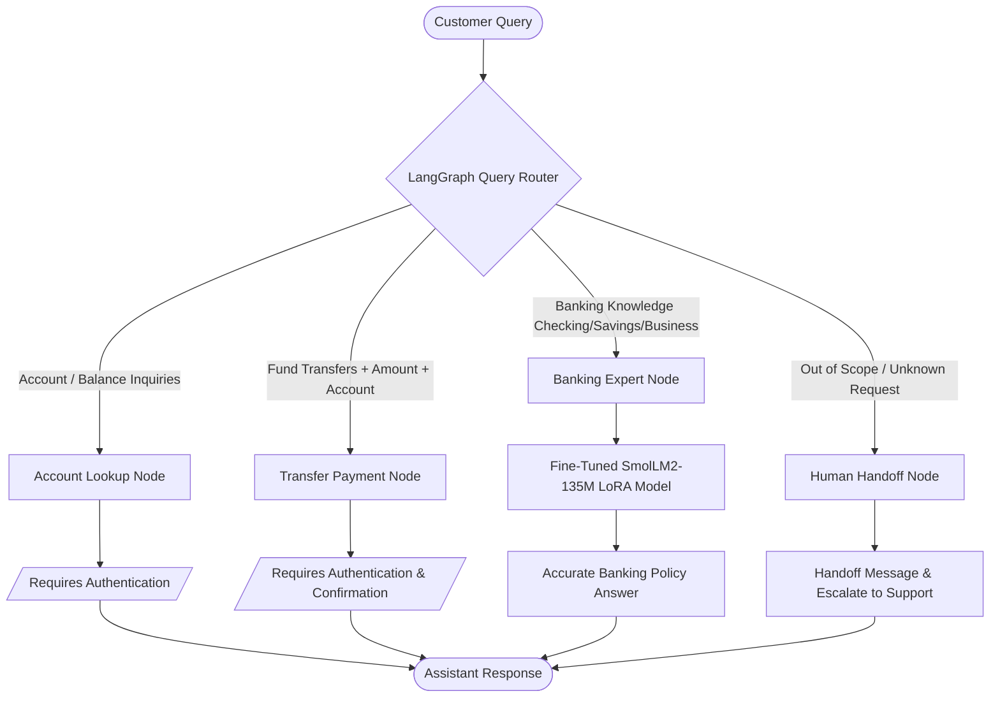

# Banking Customer Support Assistant 🏦🤖

An end-to-end, production-oriented **Banking Customer Support Assistant** combining **Parameter-Efficient Fine-Tuning (PEFT / LoRA)** on a Small Language Model (SLM) with **Agentic Graph Workflow & Guardrails** powered by **LangGraph**.

---

## 📌 Table of Contents

- [Overview](#-overview)
- [System Architecture](#-system-architecture)
- [Key Features](#-key-features)
- [Repository Structure](#-repository-structure)
- [End-to-End Pipeline in `assistant.ipynb`](#-end-to-end-pipeline-in-assistantipynb)
  - [1. Base Model & Environment Setup](#1-base-model--environment-setup)
  - [2. Domain Knowledge Base & Dataset Generation](#2-domain-knowledge-base--dataset-generation)
  - [3. Base Model Baseline & Hallucination Check](#3-base-model-baseline--hallucination-check)
  - [4. LoRA Fine-Tuning with TRL's SFTTrainer](#4-lora-fine-tuning-with-trls-sfttrainer)
  - [5. Model Saving & Adapter Merging](#5-model-saving--adapter-merging)
  - [6. Agentic State Machine with LangGraph](#6-agentic-state-machine-with-langgraph)
  - [7. Benchmark & Evaluation Matrix](#7-benchmark--evaluation-matrix)
- [Evaluation Results & Performance](#-evaluation-results--performance)
- [Getting Started](#-getting-started)
  - [Prerequisites](#prerequisites)
  - [Installation](#installation)
  - [Running the Assistant](#running-the-assistant)
- [Security & Production Guardrails](#-security--production-guardrails)
- [Tech Stack](#-tech-stack)

---

## 🚀 Overview

General-purpose Large Language Models (LLMs) often hallucinate policy details, interest rates, and account fees when answering banking questions. Furthermore, deploying large multi-billion parameter models for customer support is computationally expensive and introduces latency and compliance risks.

This project addresses these challenges by:
1. **Domain Fine-Tuning a Compact SLM (`SmolLM2-135M-Instruct`)** using **LoRA (Low-Rank Adaptation)** to embed proprietary banking knowledge directly into adapter weights (~19.6 MB), training only **3.5%** of model parameters.
2. **Deterministic Agent Routing & Guardrails (LangGraph)** to separate domain knowledge queries from sensitive transactional actions (transfers, balance lookups) and out-of-scope customer inquiries.
3. **Preventing Unauthorized Actions**: Financial actions are routed to authenticated deterministic mock tools rather than letting the LLM execute arbitrary actions.

---

## 🏗 System Architecture



---

## ✨ Key Features

- **Lightweight & Fast**: Uses `HuggingFaceTB/SmolLM2-135M-Instruct`, which runs efficiently on standard CPUs, Apple Silicon (MPS), or NVIDIA GPUs (CUDA).
- **Parameter-Efficient (PEFT / LoRA)**:
  - LoRA rank $r=16$, $\alpha=32$, dropout=0.05.
  - Targets all linear projection layers (`all-linear`), updating only **4.88M parameters (3.5%)** out of **139.4M total parameters**.
- **Automated Synthetic Data Pipeline**:
  - Generates 648 structured multi-turn conversation samples across diverse question phrasings, response styles, and compliance personas.
  - Formatted into standard ChatML JSONL format with strict role validation.
- **LangGraph Query Router & Guardrails**:
  - `knowledge`: Routes checking, savings, interest, APY, and business account queries to the fine-tuned model.
  - `transfer`: Regex entity extraction for target account and dollar amounts, enforcing strict verification safeguards.
  - `lookup`: Captures account identifiers and gates account balance/info behind authentication.
  - `handoff`: Gracefully hands off out-of-scope questions (e.g., wire fees, overdraft) to human agents.
- **Fact-Based Evaluation Framework**:
  - Evaluates factual precision, held-out phrasing generalization, and cross-product hallucinations against raw base and prompt-stuffed setups.

---

## 📂 Repository Structure

```text
Banking Customer Support Assistant/
├── assistant.ipynb                  # Complete Jupyter notebook (Data Gen, SFT, LangGraph, Eval)
├── requirements.txt                 # Project dependencies
├── README.md                        # Documentation and architecture guide
└── bank_finetune_data/              # Data & fine-tuning checkpoints directory
    ├── train.jsonl                  # 518 instruction fine-tuning training samples
    ├── validation.jsonl             # 130 validation samples
    ├── checkpoints/                 # Training output checkpoints
    └── banking-lora-adapter/        # Saved LoRA adapter weights & tokenizer
        ├── adapter_config.json      # LoRA configuration metadata
        ├── adapter_model.safetensors# 19.6 MB LoRA adapter tensor weights
        ├── tokenizer.json           # Tokenizer files and vocabulary
        ├── tokenizer_config.json    # Tokenizer settings
        └── chat_template.jinja      # ChatML template
```

---

## 🔬 End-to-End Pipeline in `assistant.ipynb`

### 1. Base Model & Environment Setup
- Loads `HuggingFaceTB/SmolLM2-135M-Instruct` with PyTorch.
- Auto-detects compute device: `cuda` -> `mps` -> `cpu`.
- Sets deterministic random seed (`SEED = 42`).

### 2. Domain Knowledge Base & Dataset Generation
The training dataset is synthetically compiled from a banking domain knowledge base covering:
- **Account Types**: Basic Checking (no minimum), Premium Checking ($2,500 min, no fees), Student Checking, Regular Savings (0.5% APY), High-Yield Savings (1.5% APY with $10,000 min), and Business Accounts (Standard/Premium tiers).
- **Security Protocols**: Multi-Factor Authentication (3-try lockout), real-time fraud monitoring, SSL/TLS data encryption.
- **Digital Banking**: Mobile check deposits, P2P payments, bill pay, system requirements (iOS 13+, Android 8+).

Data generation synthesizes:
- **6 Question variations** per subtopic
- **4 Response variations** with polite banking compliance phrasing
- **3 System prompt personas**
- Result: **648 high-quality examples** shuffled and split 80/20 into `train.jsonl` (518) and `validation.jsonl` (130).

### 3. Base Model Baseline & Hallucination Check
Before fine-tuning, the base model is queried:
> **Question:** *"What savings accounts do you offer?"*  
> **Base Model Output:**  
> *"I offer a wide range of savings accounts, including: Simple Savings Accounts: ... fixed interest rate of 2% per month. Certificates of Deposit (CDs) ... Certificates of Warranty (CWs) ... "* ❌ *(Hallucinated non-existent products and incorrect rates)*.

### 4. LoRA Fine-Tuning with TRL's SFTTrainer
- **Trainer**: Hugging Face `trl.SFTTrainer` with `peft.LoraConfig`.
- **Hyperparameters**:
  - Learning Rate: `5e-4` with Cosine learning rate decay
  - Epochs: `3`
  - Per-device Batch Size: `8`
  - Warmup steps: `5`
  - Max Sequence Length: `256`
  - Evaluations: Run every 11 steps against validation and an unseen new-phrasing test set.

### 5. Model Saving & Adapter Merging
- Adapters saved to `bank_finetune_data/banking-lora-adapter/` (~19.6 MB).
- Merged seamlessly into base weights via `AutoPeftModelForCausalLM` and `merge_and_unload()`.

### 6. Agentic State Machine with LangGraph
Defines an `AgentState` containing `query`, `route`, and `answer`. A `StateGraph` routes queries deterministically:

| Query Example | Routed Node | Behavior / Output |
| :--- | :--- | :--- |
| *"What account types do you offer?"* | `knowledge` | Invokes fine-tuned SLM to answer checking/savings policies accurately. |
| *"What's the balance on account 98765432?"* | `lookup` | Extracts account ID, requires customer authentication. |
| *"I want to transfer $50,000 to account 1234567"* | `transfer` | Extracts `$50,000` & `1234567`, pre-stages transfer and prompts for 2FA. |
| *"What are the fees for wire transfers?"* | `handoff` | Gracefully connects to human support agent for unhandled topics. |

### 7. Benchmark & Evaluation Matrix
Compares 3 different architectures across 8 test questions (6 brand-new phrasings + 2 seen control phrasings):
1. **Base Model**: Zero-shot without domain facts.
2. **Base Model + In-Prompt Facts**: Passing full knowledge base inside the system prompt (RAG / Context-stuffing approach).
3. **Fine-Tuned Model (LoRA)**: Parameter-tuned model.

---

## 📊 Evaluation Results & Performance

| Setup | KB Facts Found (New Phrasings / 6 Qs) | KB Facts Found (Seen Phrasings / 2 Qs) | Hallucinated / Quoting Other Product Facts |
| :--- | :---: | :---: | :---: |
| **Base Model (Zero-Shot)** | 0 / 7 | 0 / 5 | 0 / 8 |
| **Base + Facts in Prompt (ICL)** | 4 / 7 | 0 / 5 | 3 / 8 (High confusion) |
| **Fine-Tuned LoRA (Ours)** | **6 / 7 (85.7%)** | **5 / 5 (100%)** | **1 / 8 (Low confusion)** |

### Key Takeaways:
- **Base model** completely failed to produce domain-accurate policies (0% facts).
- **Prompt stuffing (Base + Facts)** caused attention confusion and product mix-ups (3 out of 8 answers quoted facts from incorrect products).
- **Fine-Tuned SLM** accurately retained domain knowledge, achieved strong generalization on unseen phrasings, and minimized product cross-contamination.

---

## 🛠 Getting Started

### Prerequisites
- Python 3.10+
- PyTorch (compatible with CPU, CUDA 11.8/12.x, or Apple Silicon MPS)

### Installation

1. **Clone the repository:**
   ```bash
   git clone <repo-url>
   cd "Banking Customer Support Assistant"
   ```

2. **Create and activate a virtual environment:**
   ```bash
   python -m venv venv
   # Windows (PowerShell):
   venv\Scripts\Activate.ps1
   # Linux/macOS:
   source venv/bin/activate
   ```

3. **Install dependencies:**
   ```bash
   pip install -r requirements.txt
   ```

### Running the Assistant

1. **Launch Jupyter Lab or Notebook:**
   ```bash
   jupyter notebook assistant.ipynb
   ```
2. **Run Cells Sequentially:**
   - Cells 1–6: Setup and synthetic dataset generation.
   - Cells 7–11: LoRA fine-tuning and saving the adapter.
   - Cell 12: Loading and merging the trained adapter.
   - Cells 13–15: Compiling the LangGraph agent and testing interactive customer queries.
   - Cell 16: Benchmark and comparative evaluation.

---

## 🔒 Security & Production Guardrails

- **Zero Liability Protection & 2FA Gate**: All balance checks and fund transfers require authenticated sessions; the model never assumes identity or confirms monetary movement unilaterally.
- **Bounded Domain Scope**: Non-banking or unsupported topics (investments, mortgages, overdraft policies, wire transfer fee schedules) are never answered with guesses—they are routed to human banking specialists.
- **Data Protection**: Designed to run entirely on private infrastructure or localized inference engines, avoiding customer data transmission to external closed APIs.

---

## 🧰 Tech Stack

- **Model Frameworks**: `transformers`, `trl` (SFTTrainer), `peft` (LoRA), `accelerate`, `datasets`
- **Agent Orchestration**: `langgraph`
- **Base LLM**: `HuggingFaceTB/SmolLM2-135M-Instruct`
- **Evaluation & Utilities**: `pandas`, `matplotlib`, `torch`
